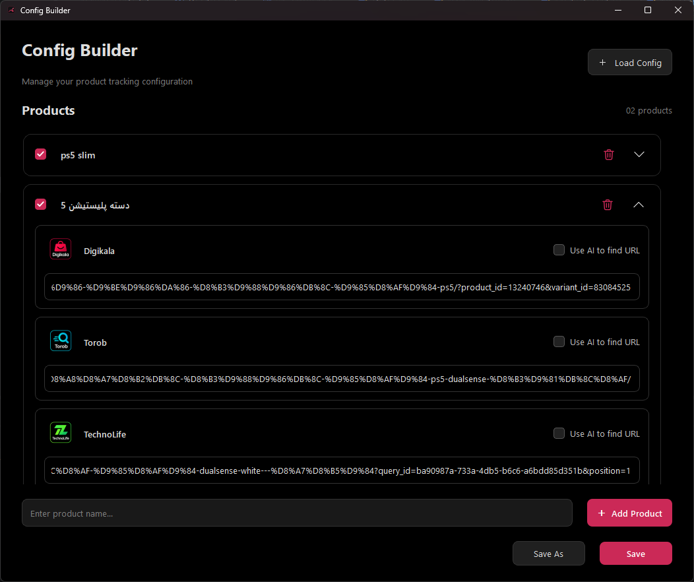

# PriceScope
[English](README.md) | [فارسی](README_FA.md)
### Iranian E-commerce Price Monitoring System

A Python-based price monitoring application for major Iranian e-commerce platforms, including **Digikala, Torob, and Technolife**.

The application collects product prices, maintains historical price records, generates PDF reports with Persian language support, and optionally sends reports via email.

## Features

- **Multi-Store Price Monitoring:** Collects product prices from Digikala, Torob, and Technolife.
- **Desktop Config Builder:** A graphical application built with PySide6 for managing products and their store URLs.
- **AI-Powered URL Discovery:** Uses Google Gemini to find product URLs when they are not provided manually.
- **Efficient Scraping Workflow:** Uses existing URLs directly and searches only for missing store URLs.
- **Product Management:** Supports adding, removing, activating, and deactivating products.
- **Price History:** Stores collected prices and timestamps in a local SQLite database.
- **PDF Reports:** Generates reports for each monitoring run, with support for Persian text rendering.
- **Email Notifications:** Optionally sends generated PDF reports through SMTP.
- **Independent Components:** The Config Builder and the main scraping application can operate independently.

## Config Builder Preview



## Supported Stores

| Store | Status |
|---|---|
| Digikala | Supported |
| Torob | Supported |
| Technolife | Supported |

## Project Structure

```text

PriceScope/
│
├── assets/
│   ├── Vazirmatn-Regular.ttf
│   └── cb_screenshot.png
│
├── config_builder/
│   ├── assets/
│   │   └── icons/
│   │       ├── check.svg
│   │       ├── digikala.png
│   │       ├── down_arrow.png
│   │       ├── icon.png
│   │       ├── technolife.png
│   │       ├── torob.png
│   │       ├── trash.svg
│   │       └── up_arrow.png
│   │
│   ├── __init__.py
│   ├── config_manager.py
│   ├── main_window.py
│   ├── product_card.py
│   ├── styles.py
│   └── ui.py
│
├── stores/
│   ├── __init__.py
│   ├── digikala.py
│   ├── techno_life.py
│   └── torob.py
│
├── .env.example
├── .gitignore
├── README.md
├── README_FA.md
├── ai_matcher.py
├── database.py
├── main.py
├── report_manager.py
├── requirements.txt
├── run_config_builder.py
├── store_manager.py
└── utils.py

```

## Requirements

- Python 3.13 or newer
- A Gemini API key (optional, required for AI-powered URL discovery)
- SMTP credentials (optional, required for email delivery)

## Installation

### 1. Clone the repository

```bash
git clone https://github.com/tavassolifard/PriceScope.git
cd PriceScope
```

### 2. Create a virtual environment

```bash
python -m venv venv
```

Activate the environment:

**Windows:**

```bash
venv\Scripts\activate
```

**Linux / macOS:**

```bash
source venv/bin/activate
```

### 3. Install dependencies

```bash
pip install -r requirements.txt
```

Install the Chromium browser required by Playwright:

```bash
python -m playwright install chromium
```

### 4. Configure environment variables

Create a `.env` file in the project's root directory by copying `.env.example`.

Example .env file contents:
```env
GEMINI_API_KEY=

SMTP_HOST=
SMTP_PORT=587
SMTP_USERNAME=
SMTP_PASSWORD=
EMAIL_FROM=
EMAIL_TO=
```

Fill in the required values depending on which optional services you want to use.

- Gemini API configuration is required only for AI-powered URL discovery.
- SMTP configuration is required only for email delivery.

The application can still extract prices from manually configured URLs without a Gemini API key. PDF reports are also generated even when email settings are not configured.

### 5. Launch the Config Builder

Run the following command from the project's root directory:

```bash
python run_config_builder.py
```

The Config Builder provides a graphical interface for:

- Adding and removing products.
- Setting product names.
- Entering store URLs manually.
- Enabling AI-powered URL discovery for missing URLs.
- Activating and deactivating products.
- Loading and saving product configurations.

After configuring your products, save the configuration.

**Important:** The generated `config.json` file must be located in the project's root directory, alongside `main.py`.

Do not move it into the `config_builder/` directory.

### 6. Run the price monitoring application

From the project's root directory, execute:

```bash
python main.py
```

The application will start monitoring the configured products.

## How It Works

1. The application loads the product configuration from `config.json`.
2. Inactive products are skipped.
3. Existing store URLs are used directly.
4. Missing store URLs can be discovered using Google Gemini.
5. Product prices are extracted from the supported stores.
6. Available price data is saved to the SQLite database.
7. A PDF report is generated using the results of the current monitoring run.
8. If SMTP settings are configured, the generated PDF report is sent via email.

## Configuration Behavior

- Each product has a unique configuration ID.
- Configuration IDs are never reused after a product is removed.
- Inactive products are skipped without deleting their historical price records.
- Removing a product from `config.json` does not delete its existing database records.
- Store URLs can be provided manually or discovered using Gemini.
- The configuration file is managed through the Config Builder.

## Database

The application uses SQLite to store historical price data.

Each monitoring run records the available prices for configured products along with their recording timestamps.

Historical records are retained even if a product is later removed from the configuration.

The database is created locally when the application runs.

## PDF Reports & Email Delivery

PDF reports are generated in the `reports/` directory.

Reports contain the results of the current monitoring run and support Persian text rendering using the Vazirmatn font.

Email delivery is optional and handled through SMTP.

If email settings are missing, the application still generates and saves the PDF report locally.

## Automation

The application is designed to run as a standalone Python program without requiring a continuously running web server.

For scheduled monitoring, Potential scheduling options include:

- Windows Task Scheduler
- Cron
- PythonAnywhere scheduled tasks
- GitHub Actions

## Limitations

- Price extraction depends on the availability and structure of the supported stores' websites.
- Changes to store websites may require updates to the scraping logic.
- AI-powered URL discovery requires a valid Gemini API key.
- Email delivery requires valid SMTP credentials.
- Monitoring is performed when the application is executed or triggered by an external scheduler.

## Technologies Used

- **Python** – Core application logic
- **PySide6** – Desktop graphical interface
- **Playwright** – Browser automation
- **Requests** – HTTP requests
- **BeautifulSoup** – HTML parsing
- **Google Gemini API** – AI-powered product URL discovery
- **SQLite** – Price history storage
- **ReportLab** – PDF report generation
- **python-dotenv** – Environment variable management

---

*Developed as a Python portfolio project.*