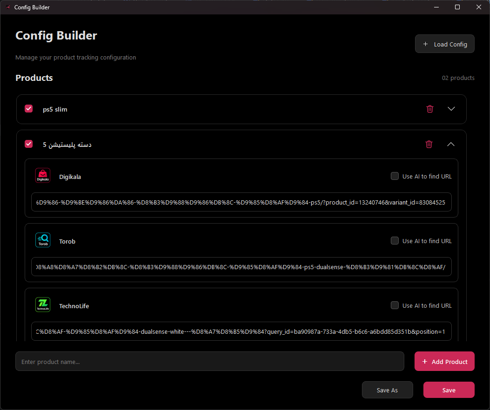

<div dir="rtl" align="right">

# PriceScope
[English](README.md) | [فارسی](README_FA.md)

### سامانه پایش قیمت فروشگاه‌های اینترنتی ایران

PriceScope یک برنامه مبتنی بر پایتون برای پایش قیمت محصولات در فروشگاه‌های اینترنتی مطرح ایران، از جمله دیجی‌کالا، ترب و تکنولایف است.

این برنامه امکان مدیریت محصولات، جمع‌آوری خودکار قیمت‌ها، ذخیره سوابق تغییرات قیمت و تهیه گزارش‌های PDF را فراهم می‌کند.

## پیش‌نمایش

### Config Builder



## امکانات

- پایش قیمت محصولات در دیجی‌کالا، ترب و تکنولایف
- مدیریت محصولات و آدرس فروشگاه‌ها از طریق رابط گرافیکی Config Builder
- شناسایی هوشمند آدرس محصولات با استفاده از هوش مصنوعی Gemini
- استفاده از آدرس‌های ذخیره‌شده و جست‌وجوی هوشمند فقط برای فروشگاه‌هایی که آدرس آن‌ها مشخص نشده است
- ذخیره تاریخچه قیمت محصولات در پایگاه داده SQLite
- تولید گزارش‌های PDF از وضعیت قیمت‌ها
- ارسال اختیاری گزارش‌ها از طریق ایمیل
- امکان فعال یا غیرفعال کردن محصولات
- جداسازی ابزار مدیریت تنظیمات از برنامه اصلی پایش قیمت

## پیش‌نیازها

- Python 3.13 یا بالاتر
- اتصال به اینترنت
- کلید API سرویس Gemini برای قابلیت جست‌وجوی هوشمند آدرس محصولات

## نصب و راه‌اندازی

ابتدا مخزن پروژه را دریافت کنید:

</div>

```bash
git clone https://github.com/USERNAME/PriceScope.git
cd PriceScope
```

<div dir="rtl" align="right">

یک محیط مجازی ایجاد و فعال کنید:

</div>

```bash
python -m venv venv
```

<div dir="rtl" align="right">

**در ویندوز:**

</div>

```bash
venv\Scripts\activate
```

<div dir="rtl" align="right">

**در لینوکس و macOS:**

</div>

```bash
source venv/bin/activate
```

<div dir="rtl" align="right">

وابستگی‌های پروژه را نصب کنید:

</div>

```bash
pip install -r requirements.txt
```

<div dir="rtl" align="right">

سپس مرورگر Chromium موردنیاز Playwright را نصب کنید:

</div>

```bash
python -m playwright install chromium
```

<div dir="rtl" align="right">

## ساختار پروژه

</div>

```text
PriceScope/
├── main.py
├── run_config_builder.py
├── store_manager.py
├── ai_matcher.py
├── database.py
├── report_manager.py
├── utils.py
├── requirements.txt
├── .env.example
├── .gitignore
├── assets/
│   ├── Vazirmatn-Regular.ttf
│   └── cb_screenshot.png
├── config_builder/
│   ├── config_manager.py
│   ├── main_window.py
│   ├── product_card.py
│   ├── styles.py
│   ├── ui.py
│   ├── __init__.py
│   └── assets/icons/
│       ├── check.svg
│       ├── digikala.png
│       ├── technolife.png
│       ├── torob.png
│       └── trash.svg
└── stores/
    ├── digikala.py
    ├── techno_life.py
    ├── torob.py
    └── __init__.py
```

<div dir="rtl" align="right">

## تنظیمات

فایل `.env.example` را به `.env` تغییر نام دهید و مقادیر موردنیاز را در آن وارد کنید.

برای استفاده از قابلیت جست‌وجوی هوشمند، کلید API مربوط به Gemini را تنظیم کنید.

تنظیمات محصولات و آدرس فروشگاه‌ها از طریق Config Builder مدیریت می‌شوند. این ابزار فایل `config.json` را در مسیر اصلی پروژه ایجاد می‌کند.

## اجرای برنامه

### اجرای Config Builder

برای باز کردن رابط گرافیکی مدیریت محصولات و تنظیمات:

</div>

```bash
python run_config_builder.py
```

<div dir="rtl" align="right">

### اجرای برنامه اصلی

برای شروع فرایند پایش قیمت:

</div>

```bash
python main.py
```

<div dir="rtl" align="right">

## گزارش‌ها

گزارش‌های PDF در پوشه `reports` ذخیره می‌شوند.

ارسال ایمیلی گزارش‌ها اختیاری است و در صورت پیکربندی نشدن تنظیمات SMTP، برنامه از این مرحله عبور می‌کند.

## اجرای خودکار

PriceScope به‌صورت یک برنامه مستقل اجرا می‌شود و نیازی به فعال بودن دائمی یک وب‌سرور ندارد.

برای اجرای زمان‌بندی‌شده می‌توانید از ابزارهایی مانند موارد زیر استفاده کنید:

- Windows Task Scheduler
- Cron
- PythonAnywhere
- GitHub Actions

## فناوری‌های استفاده‌شده

- Python
- PySide6
- SQLite
- Playwright
- BeautifulSoup
- Google Gemini API
- ReportLab

## مجوز

این پروژه برای اهداف آموزشی و نمونه‌کار توسعه داده شده است.

</div>
